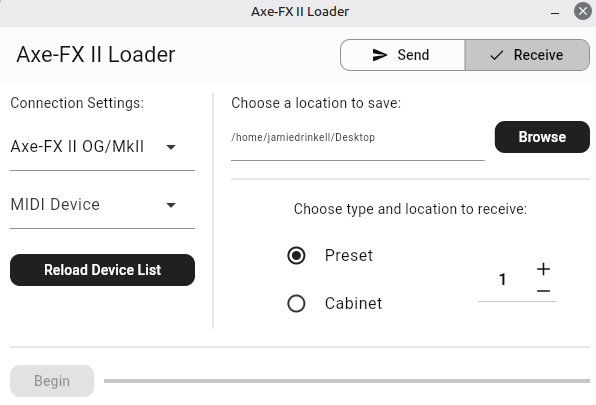

# ARCHIVED

Please use it's replacement [axeiiloader](https://github.com/M0JXD/axeiiloader).

I have been waiting for a long time for bugs in [FlutterMidiCommand](https://github.com/InvisibleWrench/FlutterMidiCommand) to be fixed.
When work started again on the package, my issue reports got marked as stale, then later automatically closed without so much as a check or report by the maintainer.
I understand I am not owed anything and could have contributed fixes myself, but I stand by issue should not have been closed just for being "old".

Moreso, Dart/Flutter does not work on BSD OSes and likely never will. This is something I can no longer accept.
In the future I might add support for more platforms to axeiiloader, encourage me to do so by making an issue there...

# Axe-FX II Loader

 

A simple utility for loading presets and IRs in and out of an Axe-FX II on Linux.
Made as an alternative to Fractal-Bot to avoid needing to rely on Wine, as it breaks on occasion.
Only tested on Linux Mint 22.2 with an Axe-FX II MkII. XL(+) units are unsupported.

NO WARRANTY IS PROVIDED, USE AT YOUR OWN RISK.

## Notes

- If the Axe-FX is sending MIDI clock pulses (which it will start doing after requesting the firmware version, e.g. via Fractal-Bot) this utility will not work!
- Refresh devices doesn't remove unplugged devices from the list (if you restart the app it will clear). However new devices appear, and re-plugged devices continue to work with the stubborn entry. This seems to be a limitation of the MIDI library and out of my hands 🙁
- There are various bugs in the MIDI library I'm having to work around which might cause you issues if trying to use the receive mode after using the send mode, or are trying to change devices. For now, if transfers stop working, restart the app.

## Download

The releases page has a portable release bundle for x86-64 Linux.
Just extract and run (you might need to use chmod).  
You need to keep the lib and data directories relative to the executable.

You might need to install some packages that Flutter needs.
On Debian style distros, these packages can be installed with `sudo apt-get install libgtk-3-0 libblkid1 liblzma5`.

## Credits

Thanks to:
- Geert Bevin's very handy ReceiveMIDI tool - https://github.com/gbevin/ReceiveMIDI
- The Wine contributors, which has let me run Fractal-Bot and Axe-Edit fairly well
- The contributors to the Axe-FX Wiki's
